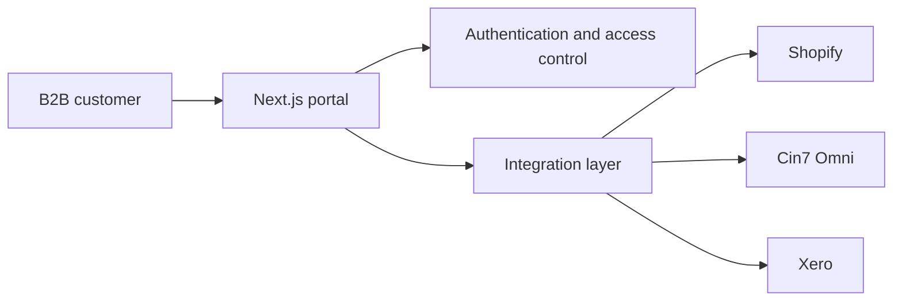

# B2B Customer Portal

**Real-time customer portal across Shopify, Cin7 Omni and Xero**

     

> [!NOTE]
> **Source code is private by design.** This project was delivered for a client under confidentiality. Publishing the source, schemas or detailed integration logic would make the system easy to reverse-engineer, and in a fast-moving market that would put the client's business at risk. This repository is a case study only: what was built, how it is structured at a high level, and what I contributed.

## Overview

A secure B2B portal that gives business customers real-time access to their orders, invoices, backorders and account balance across three stores, by bringing together data from Shopify, Cin7 Omni and Xero. Built in Next.js to OWASP ASVS Level 2 security standards.

## What was built

- Customer-facing portal built in Next.js
- Real-time views of orders, invoices, backorders and account balance
- Integrations with Shopify, Cin7 Omni and Xero
- Support for three stores in a single portal
- Security designed to OWASP ASVS Level 2

## Architecture (high level)

A simplified map of the main building blocks. Internal services, data models and integration details are intentionally left out.

## Tech stack

| Layer | Technologies |
|---|---|
| App | Next.js |
| Integrations | Shopify, Cin7 Omni, Xero |
| Security standard | OWASP ASVS Level 2 |

## Engineering highlights

- Security treated as a design input, targeting OWASP ASVS Level 2 from the start
- One consistent view for customers across three separate systems
- An integration layer keeps each third-party API isolated from the user interface

## My role

Architecture, development and system integration.

## Links

- Client site: https://megaofficesupplies.com.au

## What is in this repository

- This README with the project overview and architecture map
- No client source code, credentials, data or internal documentation

---

Built by **[Muhammad Kamran](https://github.com/raiskami)** at **[SvnStack](https://svnstack.com)**

[Website](https://svnstack.com) · [LinkedIn](https://www.linkedin.com/in/muhammad-kamran-391a50345) · [Upwork](https://www.upwork.com/freelancers/muhammadkamran128)

